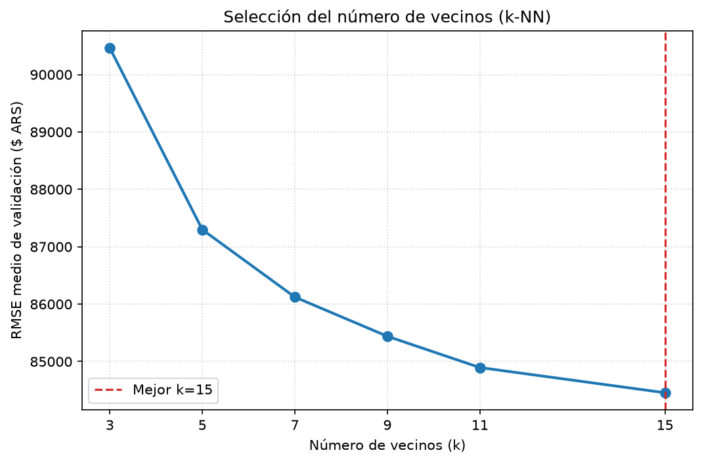

# Estimación de Precios de Airbnb en Buenos Aires

Trabajo práctico de **Python para Ciencia de Datos**. A partir de los datos abiertos de [Inside Airbnb](https://insideairbnb.com/get-the-data/), se modela y estima el **precio nocturno** de publicación de los alojamientos en la Ciudad Autónoma de Buenos Aires utilizando `scikit-learn`.

El proyecto resuelve dos problemas clave de la guía de trabajos prácticos:

| Ejercicio | Pregunta de Negocio / Hipótesis | Modelo Implementado | R² en Prueba | RMSE en Prueba |
| :---: | :--- | :--- | :---: | :---: |
| **3** | ¿Permite la cantidad de reseñas estimar el precio? | Regresión lineal simple (`number_of_reviews`) | `0,0001` | `$92.849,61 ARS` |
| **6** | ¿Cuántos vecinos ($k$) conviene consultar para estimar el precio? | $k$-NN para regresión ($k=15$, `weights="distance"`) | `0,1921` | `$80.753,06 ARS` |

> **Nota:** Todos los precios y métricas de error están expresados en pesos argentinos ($ ARS). Las conclusiones detalladas se encuentran en [`reports/conclusiones.md`](reports/conclusiones.md) y en el informe técnico [`docs/informe.docx`](docs/informe.docx).



---

## 1. Estructura del Proyecto

El repositorio ha sido reorganizado para máxima simplicidad, separación de responsabilidades y ejecución directa:

```text
proyecto-airbnb/
├── README.md                   # Descripción general, instalación y guía de uso
├── .gitignore                  # Exclusiones de Git (entornos, datos pesados, cachés)
├── pyproject.toml              # Configuración de herramientas y pytest
├── requirements.txt            # Dependencias del proyecto
├── data/
│   ├── raw/                    # listings.csv.gz original (Inside Airbnb)
│   └── processed/              # Datasets limpios generados por los ejercicios
├── notebooks/
│   └── 01_eda.ipynb            # Análisis exploratorio exhaustivo y decisiones metodológicas
├── src/
│   ├── pipeline.py             # Funciones compartidas (carga, limpieza, recorte, métricas)
│   ├── ejercicio3.py           # Script autónomo: Regresión lineal simple
│   └── ejercicio6.py           # Script autónomo: Selección de k en k-NN
├── tests/
│   └── test_pipeline.py        # Tests automatizados con pytest
├── reports/
│   ├── figures/                # Gráficos generados (dispersion, recta, k_vs_rmse)
│   ├── conclusiones.md         # Resumen analítico y métricas de evaluación
│   ├── decisiones.md           # Justificación metodológica (recorte p1/p99, weights, etc.)
│   └── consignas.md            # Consignas originales del trabajo práctico
└── docs/
    └── informe.docx            # Informe técnico y metodológico completo en Word
```

---

## 2. Instalación de Dependencias

Requiere **Python 3.10** o superior.

1. Clonar o descargar el repositorio.
2. (Opcional recomendado) Crear y activar un entorno virtual:

```bash
# En Windows:
python -m venv .venv
.venv\Scripts\activate

# En Linux/macOS:
python3 -m venv .venv
source .venv/bin/activate
```

3. Instalar las dependencias requeridas:

```bash
pip install -r requirements.txt
```

---

## 3. Ejecución de los Ejercicios y Tests

Cada script en `src/` es **autónomo y ejecutable directamente** desde la raíz del proyecto, sin necesidad de instalaciones editables ni configuraciones adicionales de variables de entorno:

### Ejecutar Ejercicio 3 (Regresión Lineal Simple)
```bash
python src/ejercicio3.py
```
*Genera los gráficos `reports/figures/ej3_dispersion.png` y `ej3_recta.png`, exporta `data/processed/ej3_limpio.csv` e imprime las métricas de prueba, estimación para 50 reseñas y comparación con el baseline.*

### Ejecutar Ejercicio 6 (k-NN con Ponderación por Distancia)
```bash
python src/ejercicio6.py
```
*Ejecuta la validación cruzada de 5 pliegues para $k \in \{3, 5, 7, 9, 11, 15\}$ usando `weights="distance"`, genera `reports/figures/ej6_k_vs_rmse.png`, exporta `data/processed/ej6_limpio.csv` y reporta las métricas finales en prueba y la estimación para un caso puntual.*

### Ejecutar los Tests Automatizados
```bash
pytest
```
*(O alternativamente: `python -m pytest`)*

---

## 4. Análisis Exploratorio de Datos (EDA)

En `notebooks/01_eda.ipynb` se encuentra el análisis exploratorio integral que fundamenta las decisiones del proyecto:
- Diagnóstico de valores ausentes (7,12% en precio, 1,75% en camas).
- Justificación del recorte por percentiles [1%, 99%] ($26.907,14 a $899.463,19 ARS) ante valores atípicos que superaban los $160 millones de pesos.
- Matriz de correlaciones entre capacidad (`accommodates`, `bedrooms`, `beds`), estancia mínima y precio.
- Justificación de la estandarización (`StandardScaler`) y ponderación por distancia (`weights="distance"`) para algoritmos basados en distancias.

---

## 5. Obtención de los Datos Crudos

El archivo de datos original (`listings.csv.gz`) se encuentra en `data/raw/` o puede descargarse directamente de:
1. Visitar [Inside Airbnb - Buenos Aires](https://insideairbnb.com/get-the-data/).
2. Descargar el archivo **`listings.csv.gz`** (*Detailed Listings data*).
3. Ubicarlo en la carpeta `data/raw/listings.csv.gz` sin descomprimir.

> **Nota de reproducibilidad:** Los valores y coeficientes reportados corresponden a la extracción oficial de **septiembre de 2026** provista para el trabajo práctico.

---

## 6. Licencia

Datos provistos por [Inside Airbnb](https://insideairbnb.com/buenos-aires/) bajo licencia [Creative Commons Attribution 4.0 International (CC BY 4.0)](https://creativecommons.org/licenses/by/4.0/).
