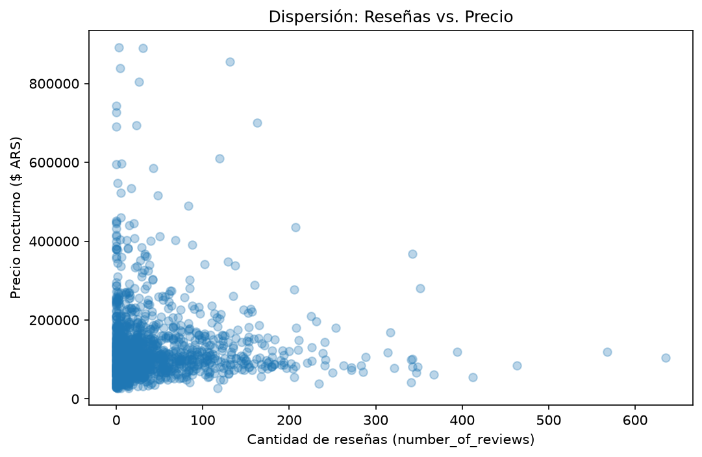
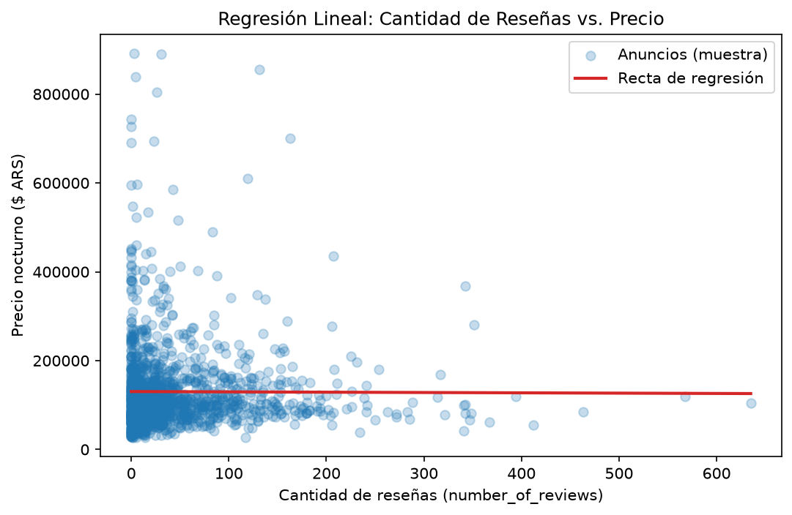
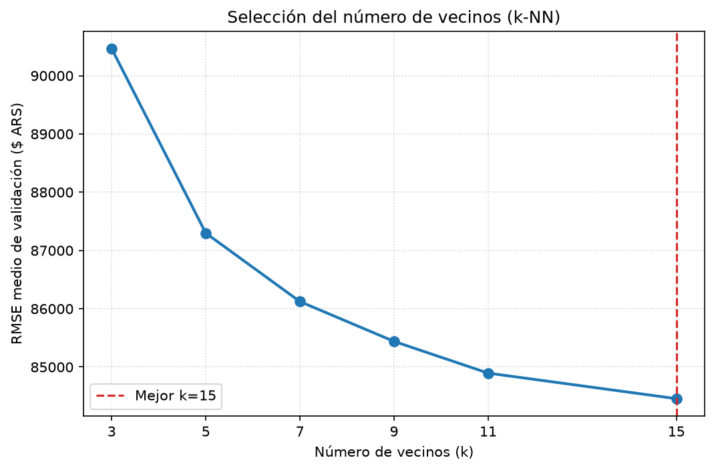

# Gráficos del Trabajo Práctico

Dataset: Inside Airbnb Buenos Aires (`listings.csv.gz`). Variable objetivo: precio por noche (`price`, en $ ARS). Los gráficos están separados por consigna.

---

## Consigna 3: Cantidad de reseñas y precio

**Pregunta:** ¿se puede estimar el precio nocturno usando solamente la cantidad de reseñas (`number_of_reviews`)?

### 3.1 Dispersión: Reseñas vs. Precio

**Qué representa:** cada punto es un anuncio (muestra de 1.500). El eje X es la cantidad de reseñas y el eje Y el precio por noche. Sirve para mirar a simple vista si existe alguna relación entre ambas variables.

**Qué se observa:** la nube de puntos no muestra ninguna tendencia clara. Hay anuncios baratos y caros tanto con pocas como con muchas reseñas; los precios más altos se concentran en anuncios con pocas reseñas, pero sin un patrón definido.

### 3.2 Recta de regresión lineal

**Qué representa:** la misma nube de puntos con la recta (en rojo) ajustada por el modelo de regresión lineal simple. Muestra cómo estima el precio el modelo a partir de las reseñas.

**Qué se observa:** la recta es casi horizontal (pendiente ≈ −7,16 ARS por reseña, intercepto ≈ $130.347 ARS). Con R² = 0,0001, la cantidad de reseñas explica menos del 0,01 % de la variabilidad del precio: predecir con esta recta equivale a predecir siempre el precio medio (~$130.000 ARS). Además, correlación no implica causalidad.

---

## Consigna 6: Selección de k en k-NN

**Pregunta:** ¿cuántos vecinos (k) conviene consultar para estimar el precio buscando alojamientos similares?

### 6.1 k vs. RMSE de validación

**Qué representa:** el error de validación cruzada (RMSE medio de 5 pliegues, en $ ARS) para cada valor de k probado (3, 5, 7, 9, 11 y 15). La línea roja punteada marca el k con menor error. Sirve para elegir el hiperparámetro k.

**Qué se observa:** el error baja a medida que aumenta k, de ≈ $90.464 con k = 3 a ≈ $84.456 con k = 15, que resulta el mejor valor. La mejora se va aplanando en los valores altos. Como k = 15 es el mayor valor probado, no se puede asegurar que sea el óptimo absoluto. Con ese k, en el conjunto de prueba el modelo logra RMSE ≈ $80.753 y R² ≈ 0,19, claramente mejor que el baseline de la media.

---

## Resumen

| Consigna | Gráfico | Qué muestra |
| :--- | :--- | :--- |
| 3 | `ej3_dispersion.png` | No hay relación visible entre reseñas y precio |
| 3 | `ej3_recta.png` | La recta ajustada es casi plana (R² ≈ 0) |
| 6 | `ej6_k_vs_rmse.png` | El menor error de validación se da con k = 15 |
